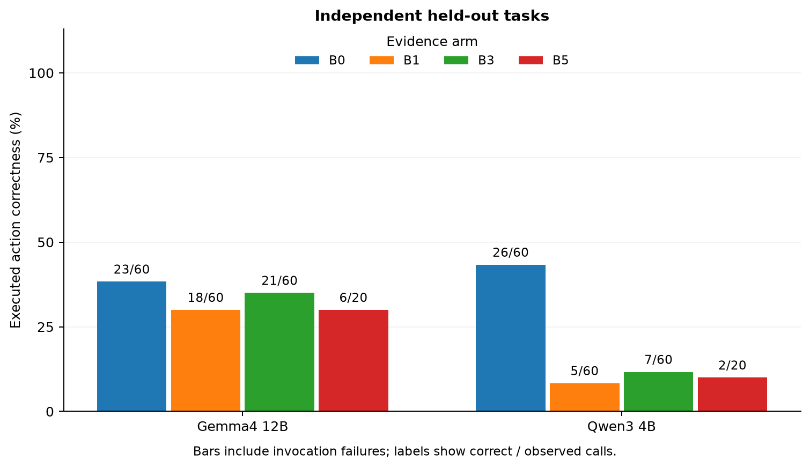
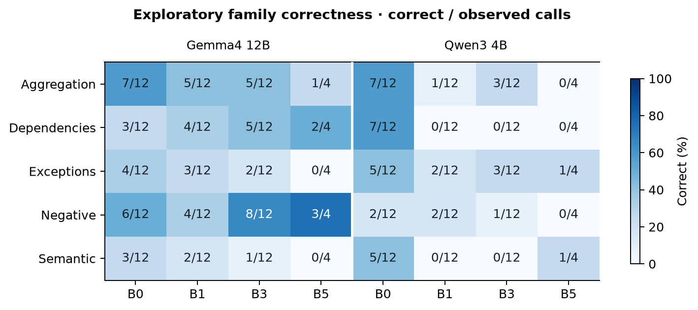
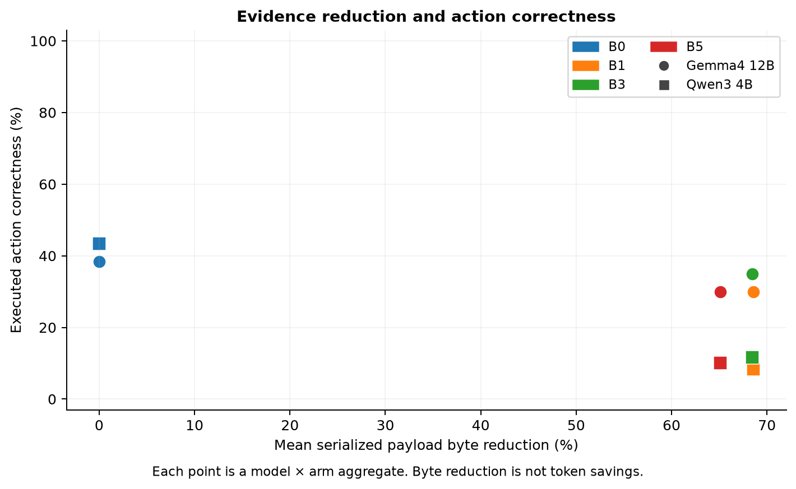
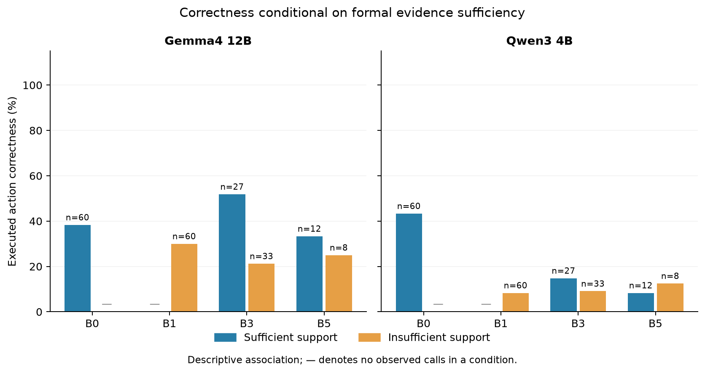
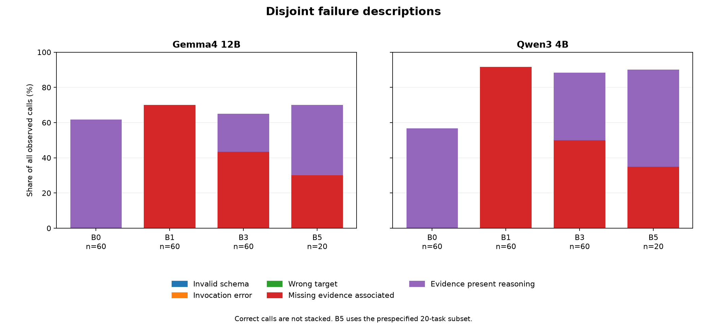
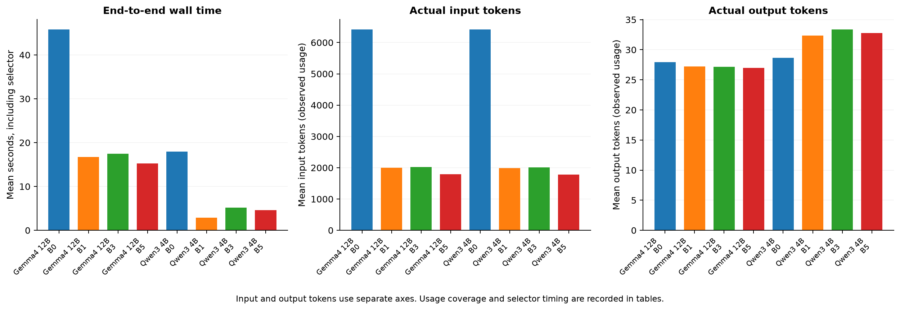

# Decision-critical evidence pilot — executed feasibility report

Verdict: **NO-GO**. The public deterministic query solves every independent benchmark task; no selector contribution is established in this structured setting.

This report summarizes stored invocations, including failed calls. Prior prototype numbers are excluded. All conclusions are limited to the implemented synthetic benchmark.

## 1. Research question and frozen protocol

Does budgeted evidence selection preserve executed procurement-action correctness relative to full evidence? The preregistered hypotheses concern truncation/lexical losses, formal evidence sufficiency, safe deferral, and the competing explanation that structured querying solves the task.

Freeze SHA-256: `424d83723b2aca6f2df1696d138dff01b3389a504676670e5e6c6552f8aab2da`. Protocol SHA-256: `381c65c4f59109c55b7a93d948f1442f0f160d4da95cf8e8166f33984c749239`. Frozen at `2026-11-18T15:54:59Z`. Configuration and source snapshots: [frozen manifest](frozen/manifest.json). See [protocol](../docs/03_PROTOCOL.md).

## 2. Literature and novelty

Primary-source review artifacts: [LITERATURE_MATRIX_VERIFIED.md](../docs/LITERATURE_MATRIX_VERIFIED.md), [NOVELTY_RISKS.md](../docs/NOVELTY_RISKS.md). The source audit must be read separately; statistical results do not establish novelty. B5 is generic query-biased graph extractive compression, not a faithful reproduction of a published compressor. Structured query execution, completeness certificates, database provenance, retrieval, and existing compression systems are substantial overlap threats.

## 3. Workflows, benchmark, and validity

The prespecified LLM subset of the 100 frozen independent test tasks contains 60 tasks across 5 observed families: aggregation, dependencies, exceptions, negative, semantic. Tasks are synthetic procurement decisions with executable APPROVE/REJECT/DEFER outcomes. For example, a purchase can depend on an alias-linked contract and its latest check; aggregates need every eligible charge, and a negative decision needs truthful source and retained-scope completeness. Private gold support/action/state are excluded from model-facing selectors. Linked order variants and counterfactual twins are not independent tasks.

[Dataset manifest](../data/manifests/dataset.json), [validation](validation.json). Validation artifact:

```json
{"checks":["repeated generation","split uniqueness","oracle SQL agreement","isolated action execution","private export leakage","source counts","counterfactual flips","order invariance","all selector budgets"],"counts":{"development":30,"stress":20,"test":100},"manifest_sha256":"f061e9aa66ad751fef649c356bc77a18047ffc84e9a05f9b8c7f045efa966862","unique_payload_hashes":150,"valid":true}
```

## 4. Baselines and fairness

B0 receives full observed evidence; B1 receives head records; B3 uses BM25 lexical ranking. B2 seeded random, B6 private-support oracle, and EXACT_KEY are model-free diagnostics. B6 is an unbudgeted privileged upper bound and is not a usable method. B5 uses generic graph extraction on the prespecified balanced subset. Budgeted selectors share the serialized-byte cap, public request, policy, schema, scope counts, and upstream completeness. B0 is unconstrained. A 2,000-byte floor can exceed 25% for small payloads.

B4 deterministic query executes public policy over the full structured result: 60/60 correct (60 planned). Its privilege is direct access to typed records and explicitly executable policy, without the LLM payload restriction; it sees no private gold and can invalidate the need for an LLM selector in this setting. Its SQL/reference agreement is a validation check, not a claim of realistic database coverage.

## 5. Runtime and coverage

Stored calls: 440/440 planned units, 440 unique. Missing: 0; unexpected: 0; duplicates: 0. Invocation errors: 0. Errors count as failures and are never rerolled selectively. Context: 40960 tokens; output limit: 160; temperature: 0; seed: 20261118; retry policy: `no_retries_errors_count_as_failures`. Models execute sequentially via local Ollama. Exact model metadata/digests:

| Model | Digest | Stored bytes |
| --- | --- | --- |
| gemma4:12b-it-qat | 38044be4f923e5a55264ed7df4eaac2676651a905f735197c504045140c02bd3 | 7151003754 |
| qwen3:4b-instruct-2507-q4_K_M | 0edcdef34593eac1aa2be9c7d06c432dcf81945adca5eca2f27662c18f168ba0 | 2497293803 |

[Runtime metadata](environment/runtime.json), [coverage audit](tables/coverage.json). Raw-file SHA-256: `8dc908666acf694c36c62534119f804151bc3d7d055368e5fd9efd835b5ad1d7`.

## 6. Correctness and paired uncertainty

Numerators are correct action-and-resulting-state outcomes; denominators include every observed planned invocation, including errors. Missing planned calls are reported separately and make coverage incomplete. Models are not pooled as independent replications.

| Model | Arm | Correct | Calls | Proportion correct | Errors |
| --- | --- | --- | --- | --- | --- |
| gemma4:12b-it-qat | B0 | 23 | 60 | 0.383 | 0 |
| gemma4:12b-it-qat | B1 | 18 | 60 | 0.300 | 0 |
| gemma4:12b-it-qat | B3 | 21 | 60 | 0.350 | 0 |
| gemma4:12b-it-qat | B5 | 6 | 20 | 0.300 | 0 |
| qwen3:4b-instruct-2507-q4_K_M | B0 | 26 | 60 | 0.433 | 0 |
| qwen3:4b-instruct-2507-q4_K_M | B1 | 5 | 60 | 0.083 | 0 |
| qwen3:4b-instruct-2507-q4_K_M | B3 | 7 | 60 | 0.117 | 0 |
| qwen3:4b-instruct-2507-q4_K_M | B5 | 2 | 20 | 0.100 | 0 |

Paired arm minus B0 differences, in percentage points. Percentile bootstrap resamples independent task pairs with 10000 draws and seed 20261118; B5 uses only its prespecified matched B0 subset. These are exploratory pilot intervals, without multiplicity correction.

| Model | Arm | Paired n | Planned | B0 correct | Arm correct | Delta pp | 95% low | 95% high |
| --- | --- | --- | --- | --- | --- | --- | --- | --- |
| qwen3:4b-instruct-2507-q4_K_M | B1 | 60 | 60 | 26 | 5 | -35.000 | -48.333 | -21.667 |
| qwen3:4b-instruct-2507-q4_K_M | B3 | 60 | 60 | 26 | 7 | -31.667 | -45.000 | -18.333 |
| qwen3:4b-instruct-2507-q4_K_M | B5 | 20 | 20 | 8 | 2 | -30.000 | -50.000 | -10.000 |
| gemma4:12b-it-qat | B1 | 60 | 60 | 23 | 18 | -8.333 | -23.333 | 6.667 |
| gemma4:12b-it-qat | B3 | 60 | 60 | 23 | 21 | -3.333 | -20.000 | 13.333 |
| gemma4:12b-it-qat | B5 | 20 | 20 | 8 | 6 | -10.000 | -35.000 | 15.000 |

Exploratory per-family descriptives: [family table](tables/family.csv).

## 7. Evidence diagnostics, failure descriptions, and linked stress

Formal sufficiency requires retention of the private reference support set and any required source completeness. The support set is conservative decision-group provenance, not a proof of minimal necessary evidence. Missing-evidence-associated failure is descriptive; it does not identify a causal effect. Evidence-present failures can reflect policy reasoning, wrong parameters, or schema/target mistakes. Schema validity and executable validity are reported separately. Unsupported approval means APPROVE without formal sufficiency or with incorrect action; unsafe means an executable incorrect approval.

| Model | Arm | Sufficient | Unsupported approve | Unsafe | Correct defer | False defer | Schema failures | Wrong target |
| --- | --- | --- | --- | --- | --- | --- | --- | --- |
| gemma4:12b-it-qat | B0 | 60 | 18 | 18 | 2 | 4 | 0 | 0 |
| gemma4:12b-it-qat | B1 | 0 | 7 | 1 | 4 | 33 | 0 | 0 |
| gemma4:12b-it-qat | B3 | 27 | 3 | 3 | 4 | 20 | 0 | 0 |
| gemma4:12b-it-qat | B5 | 12 | 0 | 0 | 2 | 8 | 0 | 0 |
| qwen3:4b-instruct-2507-q4_K_M | B0 | 60 | 27 | 27 | 0 | 1 | 0 | 0 |
| qwen3:4b-instruct-2507-q4_K_M | B1 | 0 | 6 | 3 | 0 | 19 | 0 | 0 |
| qwen3:4b-instruct-2507-q4_K_M | B3 | 27 | 15 | 12 | 0 | 8 | 0 | 0 |
| qwen3:4b-instruct-2507-q4_K_M | B5 | 12 | 4 | 3 | 0 | 6 | 0 | 0 |

[Sufficiency-conditioned outcomes](tables/sufficiency_conditioned.csv), [scored unit records](scored.jsonl). Linked variants are descriptive only; never added to independent headline n or bootstrap. [Stress descriptives](tables/stress.csv). Order and counterfactual variants remain linked to parents; no extra independent n or inferential stress claim is made. Per-variant parent correctness, action agreement/change, and joint correctness are recorded in [linked stress comparisons](tables/stress_links.csv).

## 8. Bytes, actual tokens, and time

Payload byte reduction is serialized JSON reduction, not token savings. Token counts are measured backend prompt/output counts for calls with returned usage; failures can lack usage. Total seconds add selector overhead to inference wall time, including request/runtime overhead and possible loading. This does not measure a production pipeline or dollar savings.

| Model | Arm | Mean byte reduction (fraction) | Actual input tokens | Usage n | Actual output tokens | Selector sec | Inference sec | Total sec |
| --- | --- | --- | --- | --- | --- | --- | --- | --- |
| gemma4:12b-it-qat | B0 | 0.000 | 6420.717 | 60 | 27.917 | 0.001 | 45.830 | 45.831 |
| gemma4:12b-it-qat | B1 | 0.686 | 2003.217 | 60 | 27.233 | 0.002 | 16.706 | 16.708 |
| gemma4:12b-it-qat | B3 | 0.684 | 2021.800 | 60 | 27.167 | 0.008 | 17.424 | 17.432 |
| gemma4:12b-it-qat | B5 | 0.651 | 1789.350 | 20 | 27.000 | 0.070 | 15.174 | 15.243 |
| qwen3:4b-instruct-2507-q4_K_M | B0 | 0.000 | 6417.250 | 60 | 28.650 | 0.000 | 17.987 | 17.988 |
| qwen3:4b-instruct-2507-q4_K_M | B1 | 0.686 | 1992.717 | 60 | 32.333 | 0.002 | 2.843 | 2.845 |
| qwen3:4b-instruct-2507-q4_K_M | B3 | 0.684 | 2009.183 | 60 | 33.383 | 0.009 | 5.206 | 5.215 |
| qwen3:4b-instruct-2507-q4_K_M | B5 | 0.651 | 1776.600 | 20 | 32.800 | 0.075 | 4.564 | 4.639 |

Six reconstructible figure pairs are listed below; missing-token coverage appears in tables.








## 9. Limitations

Synthetic templated procurement workflows with typed records, explicit public policy, trustworthy scope counts, and a fixed action schema are controlled feasibility instruments. They do not establish real-world agent safety or generalization to unstructured tools. The deterministic comparator benefits from explicit executable policy and full structured access. Small local models and quantization, development calibration, limited independent task counts, conservative support labels, and linked stress dependence constrain interpretation. B5 is a generic compressor; faithful published-method reproductions are absent. Source completeness is certified by construction. Temperature zero does not guarantee bitwise runtime determinism. Error counts and absent token measurements remain visible. Novelty needs an independent primary-source audit. Counterfactual/order results are descriptive; no causal mechanism is established.

## 10. Decision and smallest justified next step

**NO-GO** — The public deterministic query solves every independent benchmark task; no selector contribution is established in this structured setting. Stop the broad selector claim for this benchmark. A future study needs independently motivated workflows whose policies cannot be fully resolved by the same public structured query; require competent full-evidence models before testing selector effects.

Reproduce: `.venv/bin/python -m evidence_pilot integrity`, then `.venv/bin/python -m evidence_pilot run` (resumes unfinished units), `.venv/bin/python -m evidence_pilot diagnostics`, `.venv/bin/python -m evidence_pilot analyze`, and `.venv/bin/python -m evidence_pilot report`. Run `.venv/bin/python -m pytest` for implementation checks. Raw records, frozen sources, private synthetic references, score rows, tables, and figure pairs support inspection.

<!-- reporting-addendum -->

**Final accounting and validity notes.** This reporting-only addendum was added after freeze. It changes no inference input, primary outcome, paired comparison, or verdict rule.

The benchmark has **100 frozen independent test tasks**, of which **60** belong to the declared two-model LLM grid. The remaining independent cases receive model-free validation/query diagnostics only. Linked stress variants remain separate.

| Diagnostic over all independent test tasks | Support sufficient | Action correct | Within byte budget | Mean byte reduction |
| --- | --- | --- | --- | --- |
| B0 | 100/100 | not inferred | 0/100 | 0.0% |
| B1 | 1/100 | not inferred | 100/100 | 68.2% |
| B2 | 2/100 | not inferred | 100/100 | 68.2% |
| B3 | 45/100 | not inferred | 100/100 | 68.1% |
| B4 | 100/100 | 100/100 | not applicable | not delivered to LLM |
| B5 | 60/100 | not inferred | 100/100 | 68.2% |
| B6 | 100/100 | not inferred | 100/100 | 90.3% |
| EXACT_KEY | 40/100 | not inferred | 100/100 | 91.8% |

Support retention is not model action accuracy. B6 is a private, unbudgeted certificate bound; EXACT_KEY is a literal-scope diagnostic. B4 receives unrestricted public structured records and preimplemented workflow/schema knowledge, with fixed-template intent parsing. Its success limits the case for an LLM selector on this task class; it does not establish that arbitrary real-world agent tasks are query-solvable.

Secondary paired family differences with 95% task-bootstrap intervals use the same frozen algorithm and matched subsets: [exploratory family pairs](tables/family_paired_exploratory.csv). Small per-family samples and multiple comparisons preclude strong subgroup claims.

| Model / arm | No executable action | Schema failures | Calls |
| --- | --- | --- | --- |
| Gemma4 12B / B0 | 0 | 0 | 60 |
| Gemma4 12B / B1 | 0 | 0 | 60 |
| Gemma4 12B / B3 | 0 | 0 | 60 |
| Gemma4 12B / B5 | 0 | 0 | 20 |
| Qwen3 4B / B0 | 6 | 0 | 60 |
| Qwen3 4B / B1 | 27 | 0 | 60 |
| Qwen3 4B / B3 | 27 | 0 | 60 |
| Qwen3 4B / B5 | 6 | 0 | 20 |

A schema-valid action can still be rejected by the simulator, for example DEFER with a nonzero amount. These failures remain incorrect outcomes.

| Model / arm | Linked variant | Pairs | Parent and variant both correct | Same JSON action |
| --- | --- | --- | --- | --- |
| Gemma4 12B / B0 | cf | 5 | 1 | 4 |
| Gemma4 12B / B0 | order | 5 | 2 | 3 |
| Gemma4 12B / B3 | cf | 5 | 0 | 5 |
| Gemma4 12B / B3 | order | 5 | 1 | 3 |
| Qwen3 4B / B0 | cf | 5 | 0 | 5 |
| Qwen3 4B / B0 | order | 5 | 1 | 5 |
| Qwen3 4B / B3 | cf | 5 | 0 | 5 |
| Qwen3 4B / B3 | order | 5 | 0 | 4 |

Linked pairs are descriptive only (five parents per model/arm/variant), never added to independent n. Counterfactual reference actions change; order-only reference actions do not. Same action is not sufficient for correctness.

**Selector replay limitation:** Four of 440 regenerated payloads (two B3 aggregation tasks across both models) can reorder tied records across Python processes. Eight fixed hash seeds reproduced two orders with identical record membership, byte caps and formal sufficiency; the maximum score difference was 8.88e-16. BM25 sums over an unordered query-token set, so floating-point tie order is not fully pinned. Frozen source and original outputs were preserved; no inference was rerun to fix this. Exact original model inputs are exported in [replay request manifest](replay_requests/manifest.json) by `.venv/bin/python scripts/export_frozen_requests.py`, which performs no inference. See [hash-seed audit](bm25_hash_seed_audit.json).

**Interruption accounting:** 440 retained planned invocation records, plus 4 confirmed backend completions with lost response bodies. The missing raw units were resumed once under the prespecified interruption policy; retained results were never rerolled. The lost actions, token counts and client/selector overhead cannot be reconstructed and are not invented. Reported primary correctness uses the retained planned grid; latency/usage tables omit lost-response overhead. See [interruption receipt](runs/heldout/interruption.json) and [experiment log](../docs/EXPERIMENT_LOG.md).

| Response cohort | Retained backend responses | Input tokens observed | Output tokens observed | Backend total seconds observed |
| --- | --- | --- | --- | --- |
| smoke | 2 | 56 | 61 | 9.85 |
| calibration | 64 | 216149 | 1884 | 805.17 |
| heldout_including_stress | 440 | 1390390 | 13010 | 7126.77 |

Calibration and smoke cohorts are excluded from test accuracy. The token/time sums above cover returned responses only; the 4 lost bodies have unknown usage. Generic B5 adds zero compressor model calls; graph/selection CPU time is in retained unit records. These are not monetary-cost estimates.

**Inference limits:** [Family-specific outcome/failure counts](tables/family_failure_counts.csv) separate evidence-present failures from missing-evidence-associated failures within dependency, precedence, aggregation, absence/coverage and alias/role tasks. Strict action-only outputs do not reveal whether an individual wrong result arose from arithmetic, rule precedence or entity resolution internally. Formal-support conditioning is descriptive and varies with family and arm. H2’s stronger predictive claim is not established by these tables. False deferral is relative to the full-source reference: when selected rows are missing, DEFER can be locally safe and policy-compliant while failing the original action objective. Missing-evidence-associated failure is not proven causal. Fixed arm order, prefix caching, background application activity and memory pressure can affect latency; no monetary savings or production throughput claim follows. A trusted scope-count interface and explicit policies are important benchmark assumptions. These are single-turn action decisions; adaptive recovery and multi-turn agent trajectories are not evaluated. Critical date patterns, policy templates and dependency depths repeat across generated cases; additional development-learned shortcuts may exist. The near-duplicate audit removes entity identifiers before comparing business-attribute multisets; high template similarity is reported in [near-duplicate audit](near_duplicate_audit.json), despite unique complete public payload hashes.

Read-only certificate replay after freeze tested 150 oracle views and 309 sufficient selector views; discrepancies: 0. [Certificate validation](sufficiency_validation.json). These are validation counts, not additional independent experiments.

**Novelty and stop decision:** The verified sources already cover task-conditioned pruning, completeness certificates, reversible recovery, structural preservation and executed-state scoring. Generic B5 cannot establish failure of published learned/reversible compressors. A benchmark-limited NO-GO supports stopping the broad selector proposal for this fully structured workflow, without claiming evidence handling is solved generally.

To regenerate this final addendum after the standard report command: `.venv/bin/python scripts/finalize_report.py`.
